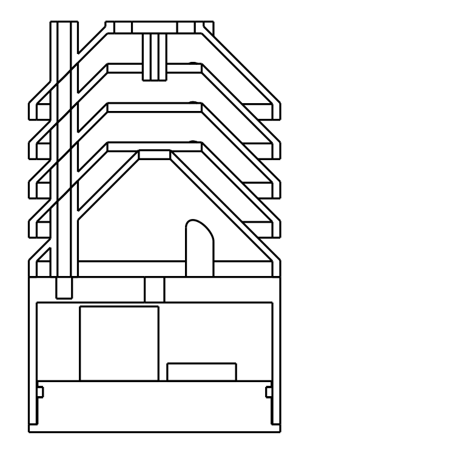

# Remote sensors

Battery powered temp/humidity sensors for the greenhouse.

```
sensor-node ──ESP-NOW──▶ gateway-radio ──UART──▶ gateway-uplink ──WiFi/MQTT──▶ mosquitto (tiger-pi)
 (battery)               (fixed channel)          (WiFi client)                   ├─▶ greenhouse controller
                                                                                  └─▶ telegraf ─▶ InfluxDB
```

- **sensor-node** wakes every 5 minutes, reads an SHT4x, sends one ESP-NOW packet and sleeps. About 100ms awake per reading.
- **gateway-radio** only listens for ESP-NOW, on `ESPNOW_CHANNEL`. It never joins WiFi, so its channel never changes when UniFi switches channels or the uplink roams to another AP. It gives itself the fixed MAC `02:47:48:00:00:01`, so sensors don't need to be told its address.
- **gateway-uplink** is an ordinary WiFi client. It publishes each reading, retained, to `greenhouse/sensors/<sensor MAC>/state`:
  ```json
  {"id":"348518abcdef","temperature":74.12,"humidity":81.20,"battery_v":2.874,"battery_used_mah":412,"battery_pct":68.3,"rssi":-67,"seq":1234,"attempt":0,"missed":0,"ts":1760000000}
  ```
  - `temperature` is °F, matching the controller.
  - `attempt` is the number of failed sends before this one got through. `missed` is the number of readings the sensor gave up on entirely since its last delivered one.
  - `battery_v` is measured with the radio on (see [Battery monitoring](#battery-monitoring)). `battery_used_mah` and `battery_pct` come from the sensor's charge count.

## Hardware

All three use a Seeed XIAO ESP32-C3.

**Gateway:** two XIAOs powered from the same USB supply, wired together:

| gateway-radio | gateway-uplink |
|---|---|
| D6 (TX) | D7 (RX) |
| D7 (RX) | D6 (TX) |
| GND | GND |

**Sensor node:**

```
CR123A + ──┬──────────────▶ boost converter IN      boost OUT (3.3V) ──▶ XIAO 3V3
           │                                        boost GND ─────────▶ XIAO GND
          100k
           ├──────────────▶ XIAO A1
          100k   10nF A1 to GND
           │
         drain
  XIAO D2 ──▶ gate   2N7002 (or similar logic-level N-MOSFET)
          100k gate to GND
         source
           │
CR123A − ──┴──── GND
```

- **Sensor:** SHT45 on SDA (D4) / SCL (D5), with a 100nF cap across its supply.
- **Power:** a 3.3V boost converter with a low idle current, such as one built on a TPS61099 (about 1µA). A CR123A sits around 2.8–3.0V under load, below the ESP32-C3's 3.0V minimum, so it can't run the XIAO directly.
  - Feed the XIAO through its **3V3 pin, never its BAT pads.** The BAT pads go to a lithium-ion charger that would try to charge the CR123A whenever USB is plugged in.
  - **Take the battery out before plugging in USB** to flash it, so the USB supply and the battery aren't both feeding the 3.3V rail.
- **Battery divider:** 100k + 100k on the battery side of the boost converter, read on A1. A MOSFET on the low side, driven from D2, connects it only while the firmware reads it, so it draws nothing during sleep.
  - **The 100k gate pull-down is required.** D2 floats in deep sleep, and the pull-down keeps the divider off.
  - A1 rather than A0 because A0 is a boot strapping pin on the C3.
- The XIAO board itself draws ~40µA in deep sleep, which a bare ESP32-C3 module wouldn't. That's most of the power budget.

## Battery monitoring

The sensor reports two independent measures.

- **Voltage under load (`battery_v`).** A CR123A's resting voltage stays nearly flat until it's almost empty. Its voltage while the radio is drawing ~100mA sags more as it wears, so the firmware takes the reading with the radio on.
- **Charge used (`battery_used_mah`, `battery_pct`).** The firmware adds up an estimate of the charge used on every wake and every sleep.
  - The running total lives in RTC memory and survives deep sleep, brownouts and watchdog resets.
  - It only resets to zero on a power-on reset, which in practice means a battery was just put in.
  - If you put a *used* battery back in, the count will restart at zero and read too optimistic.
  - **Calibrate it once:** measure the battery current with a power profiler (or a µA-range meter), then set `SLEEP_CURRENT_UA` and `AWAKE_CURRENT_MA` in `platformio.ini`. The defaults (50µA asleep, 60mA awake) are estimates. `BATTERY_CAPACITY_MAH` defaults to 1300, the usable capacity of a CR123A down to where the boost converter gives out.

The controller flags a sensor as low when it drops below 15% remaining **or** 2.6V under load, whichever comes first. The voltage check catches a battery draining faster than the estimate expects. It logs a warning to syslog when a sensor crosses either threshold, and the `remote` WebSerial command marks it `(LOW BATTERY)`.

Rough battery life on one CR123A, reading and sending every 5 minutes: about 2 years.

## Outdoor housing

`enclosure/sensor_housing.py` generates a stacked-plate radiation shield sitting on a sealed pod for the battery and electronics. It writes STEP and STL files to `enclosure/out/`. It reads the driver board's outline and part positions straight from `pcb/sensor-driver/sensor-driver/sensor-driver.kicad_pcb`, so **rerun it whenever you change that board**. `assembly.step` shows the board, its battery holder, XIAO and Qwiic header in orange, to check fit. To regenerate:

```
pip install cadquery
python sensor_housing.py
```

The script stops with an error if a change makes something not fit, for example:
- the sensor board hitting the base
- the driver board or its tall parts not fitting in the pod
- the grommet landing on a tall part
- a screw that won't reach its insert



**How the shield blocks sun but not air:**
- Every plate is a 45° cone sloping down to the outside, stacked 10 mm apart.
- Each cone is 20 mm tall, twice the gap between plates, so there's no straight path for sunlight to reach the center.
- Air flows sideways through the 5.5 mm gaps between plates. Going much tighter starts to choke the airflow on still days.
- The base closes off the bottom, so the sensor can't see sunlit ground. The cable drops through an 8 mm hole at its apex.

**The pod:**
- **Lid:** an O-ring plug, held by three radial M3 screws through the pod wall into heat-set inserts in the plug, below the O-ring.
- **Driver board:** screws to two 3 mm standoffs on the lid (M2.5 heat-set inserts) at its H1/H2 mounting holes. The standoffs clear the trimmed through-hole leads of the battery holder and headers. The battery holder sits toward one side of the pod and the XIAO and Qwiic header toward the other. The holder's top clears the pod's top by 1.1 mm and the XIAO's USB-C by 4 mm.
- **Battery changes:** removing the lid's three radial screws pulls the lid out with the whole board on it.
- **Cable:** a 200 mm Qwiic / STEMMA QT cable (JST-SH plugs on both ends) runs from the sensor board, through the base's 8 mm hole, and into the pod through a 7.5 mm hole directly above the driver board's Qwiic header, so the cable drops straight in. Both holes pass the plug, so the shield and pod come apart by unplugging both ends; nothing has to be desoldered.
- **Sealing the cable:** a split TPU grommet snaps around the cable and presses into the pod's hole from outside, with a barb that catches underneath. The base cone keeps rain off it.
  - The grommet's bore is sized for a flat four-wire cable, 4.2 × 1.2 mm. Measure yours and adjust `CABLE_W` and `CABLE_T` if it differs.
- **Shield screws:** they go into heat-set inserts in blind holes in the pod top, so nothing pierces the sealed space.
- **Condensation:** a small adhesive vent membrane on the lid helps avoid it if you see any.

**Print** in white ASA or PETG (PLA sags in sun). No supports needed; every part is exported in its print orientation.
- 1× `base`
- 3× `plate`
- 1× `cap` (exported upside down, flat side on the bed)
- 1× `pod` (exported upside down, top on the bed)
- 1× `pod_lid`
- 1× `grommet`, in **TPU** (95A or similar), flange down on the bed

**Hardware:**
- 3× M3 × 70 mm socket head screws (shield to pod)
- 3× M3 × 6 mm screws (lid)
- 6× M3 heat-set inserts, 4 mm long (3 in the pod top, 3 in the lid plug)
- 2× M2.5 heat-set inserts and 2× M2.5 × 6 mm screws (driver board to lid standoffs)
- 1× O-ring, 2 mm cross-section, about 55 mm ID
- 200 mm Qwiic / STEMMA QT cable, and two JST-SH 4-pin headers: SM04B-SRSS-TB (side entry) on the sensor board, SM04B or BM04B (vertical) on the controller board

**Sensor PCB:** designed for 15 × 15 mm, 1.6 mm thick (up to 20 mm long still fits). The side edges slide up into two slotted rails hanging from the cap.
- The rails hold only the outer 1.5 mm of each side edge, over the top 6 mm. Keep components out of those strips, and don't let anything stick up past the top edge.
- Put the sensor below the rails, with its 0.1µF cap next to its VDD pin, and a side-entry JST-SH header (SM04B-SRSS-TB) on the bottom edge facing down, so the cable drops straight to the cable hole. Qwiic pinout: black GND, red 3.3V, blue SDA, yellow SCL. Change `PCB_W`, `PCB_T`, `PCB_LEN` and `RAIL_LEN` in the script to fit a different board. A drop of glue or a snug fit holds it in.

**Overall:** 64 mm diameter, 108.5 mm tall. The cap's two M4 holes are for mounting to a bracket or arm.

## Channel

`ESPNOW_CHANNEL` (default 11) is set in `code/include/remote_sensor_protocol.h`. Sensors and gateway-radio must be flashed with the same value. Pick a 2.4GHz channel the UniFi APs aren't using.

## Building

From `code/`:

```
pio run -e sensor-node -t upload
pio run -e gateway-radio -t upload
pio run -e gateway-uplink -t upload
```

- `sensor-node-debug` reads every 30s and prints to USB serial.
- `gateway-uplink` uses the controller's `controller/code/src/wifi-info.h` for WiFi credentials, and the `embedded-shared` libraries for WiFi and syslog.
- All three must run the same packet version (`SENSOR_PACKET_VERSION`); the gateway radio rejects packets from a different version.

## tiger-pi

1. Install the broker:
   ```
   sudo apt install mosquitto
   ```
2. Copy `tiger-pi/mosquitto-greenhouse.conf` to `/etc/mosquitto/conf.d/greenhouse.conf`, then restart mosquitto.
3. Copy `tiger-pi/telegraf-greenhouse-sensors.conf` to `/etc/telegraf/telegraf.d/`, then restart telegraf. Read the note at the top of that file if this Telegraf already writes to other outputs.

Readings land in the `greenhouse` database:
- measurement: `weather`
- tags: `device=greenhouse-remote`, `sensor_id=<MAC>`
- fields: `temperature`, `humidity`, `battery_v`, `battery_used_mah`, `battery_pct`, `rssi`, `seq`, `attempt`, `missed`

To watch the raw stream:

```
mosquitto_sub -h tiger-pi.local -t 'greenhouse/#' -v
```

## Controller

The controller subscribes to `greenhouse/sensors/+/state` through `RemoteSensors` (`controller/code/lib/RemoteSensors`). It keeps the latest reading from each sensor in `SENSORS->remote->readings()`. The `remote` WebSerial command lists them with their age and battery state. Readings older than 15 minutes are marked stale.
